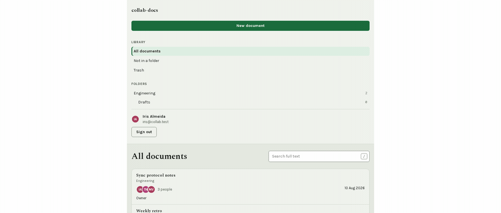
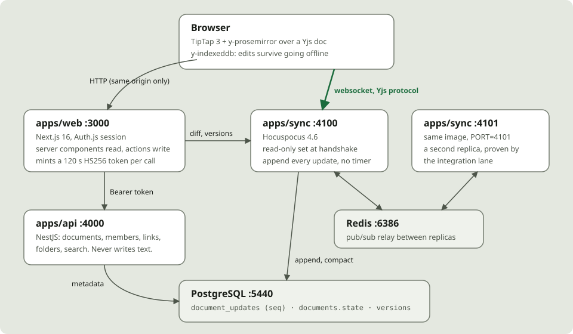

# collab-docs: a document several people write at once, that survives `kill -9`

[](https://github.com/bastian-red/collab-docs/actions/workflows/ci.yml)

A collaborative editor in the shape of Google Docs: rich text, live carets with names on them,
version history with restore, share links that carry a role, and editing that keeps working with
the network down. TipTap 3 over a Yjs CRDT, a Hocuspocus sync server that runs as more than one
replica, NestJS for everything that is not the document, PostgreSQL underneath.





## Why the obvious persistence loses data

Wiring Yjs to an editor is an afternoon. Every quick-start then persists the document the same way:
keep the `Y.Doc` in memory and write `encodeStateAsUpdate(doc)` to a row on a debounce. Hocuspocus
ships exactly that as `@hocuspocus/extension-database`, debounced by default.

It loses data, silently. Everything typed between the last write and a crash is gone, and the
window is the debounce interval, which is measured in seconds precisely because writing on every
keystroke is expensive. A person who typed a paragraph and closed the laptop gets a document missing
a paragraph, with no error anywhere.

So here the debounced write is not the durable copy. **Every Yjs update is appended to a Postgres
log the moment it is applied**, with a gapless `seq` allocated by `UPDATE ... RETURNING` inside the
same transaction as the insert. `documents.state` is only a compaction of that log, and compaction
is safe to interrupt at any instant because applying a Yjs update is idempotent and commutative:

| The process dies... | On reload | Because |
|---|---|---|
| before the compaction `UPDATE` | old checkpoint + the whole log | nothing was truncated |
| between `UPDATE` and `DELETE` | new checkpoint + rows already folded in | re-applying them is a no-op |
| after the `DELETE` | new checkpoint + the remaining tail | the ordinary case |

The integration lane proves it by writing, sending the sync process `SIGKILL` before any debounce
could fire, restarting it, and reading the tail back.

## What it has to get right, and the test that holds each

| Property | Proved by |
|---|---|
| Concurrent edits converge from any delivery order | gate: seeded N-client property test with random interleaving and duplication |
| ...across two server processes | integration: clients on :4100 and :4101; removing the Redis extension turns exactly those tests red |
| A crash does not lose the tail | integration: `kill -9` before any debounce, restart, the text is there |
| Compaction is safe at every interruption | gate: the log replayed shuffled, duplicated and twice, byte-identical |
| The log has no gaps under concurrency | integration: twelve interleaved appends across both replicas, checked for density |
| A viewer cannot write | integration: a hand-built Yjs update from a `VIEWER` connection is dropped by the server |
| Two people converge in real browsers | E2E: two contexts type, both documents are equal |
| Offline edits merge | E2E: both people go offline, type different text, reconnect, both have both |
| A caret is identifiable without colour | E2E: the writer's name is found as text inside the other person's editor |
| Restore reaches every replica and every writer | integration + E2E: a second writer converges on the restored text |
| No route has an accessibility violation | E2E: axe over every route and dialog, both colour schemes, zero violations, no disabled rules |
| `pnpm dev` works from a fresh clone | `scripts/dev-smoke.sh`, with every `.env` name stripped from its environment |

## Read-only is enforced by the server, not the editor

Once a client is in a Yjs room, the protocol lets it send anything. A read-only role enforced by
setting `editable: false` is a suggestion to code running on the reader's machine. Here the sync
server's `onAuthenticate` resolves the caller's role through the same permission matrix the REST API
uses, and sets `connectionConfig.readOnly` for `COMMENTER` and `VIEWER`; Hocuspocus then drops their
writes before they reach the document. The editor's read-only banner explains the rule. The server
is the rule.

Version restore follows from that rather than restating it: restoring is an ordinary edit made by
the client, so a viewer's restore is dropped at the server exactly like a viewer's keystroke.

## Garbage collection is on, and what that costs

Yjs can attribute every character to an author, at the price of `gc: false`: every deleted item
kept forever, in memory and in every row. This repo keeps garbage collection on, so storage tracks
the current document and the size ceiling means something. The consequence is stated in the UI as
well as here: a version says who **cut** it, never who wrote a word, and the diff is text-level.

## The design: a desk with a page on it

Every sibling project in this portfolio paints its background as paper. Here the background is a
mid-tone sage desk and the document is a separate white sheet, 816px wide with a 640px measure, set
in Spectral at 18/1.72. The prose face appears only on the page and in document titles; the chrome
is Karla, so a reader can tell somebody's writing from the application by typography alone.

Colour is never the only channel. Every caret carries its writer's name, always rendered. The sync
state is a glyph and a word (`● Synced`, `◐ Saving`, `▲ Offline`, `⚠ Not saving`), and a gate test
asserts the four colours collapse to one grey, which is the evidence the words are doing the work.
Every colour pair is measured against WCAG AA from the real stylesheet in both schemes.

## Running it

Requirements: Node 20, pnpm 9, Docker.

```bash
git clone https://github.com/bastian-red/collab-docs.git
cd collab-docs
pnpm install

cp .env.example .env
sed -i "s|^AUTH_SECRET=|AUTH_SECRET=$(openssl rand -base64 32)|" .env

docker compose -f infra/docker-compose.yml up -d   # Postgres :5440, Redis :6386
pnpm db:deploy
pnpm db:seed

pnpm dev    # web :3000, api :4000, sync :4100
```

Open http://localhost:3000 and sign in as `iris@collab.test` / `demo-password-2026`. Open a second
browser (or a private window) as `theo@collab.test` with the same password, open "Sync protocol
notes" in both, and type. `mara@collab.test` is a viewer.

The whole stack in containers, two sync replicas included, migrated and seeded:

```bash
docker compose -f infra/docker-compose.yml --profile app up -d --build
```

`pnpm dev` goes through `scripts/dev.sh`, which loads `.env`, checks `AUTH_SECRET` and that Postgres
and Redis answer, then starts turbo. Turbo runs in strict environment mode and reads no `.env` on its
own, so `turbo run dev` directly starts an API with no secret.

## Testing

| Lane | Command | What it needs |
|---|---|---|
| Gate (632 unit tests, plus the four design gates) | `pnpm test` | nothing |
| Environment contract | `pnpm env:contract` | nothing |
| Schema drift and seed check | `pnpm db:drift`, `pnpm db:seed:check` | Postgres |
| Integration (two sync replicas + the API graph) | `pnpm test:integration` | Postgres, Redis |
| Dev smoke | `./scripts/dev-smoke.sh` | Postgres, Redis, a seeded database |
| E2E (Chromium + Firefox, axe in both schemes) | `pnpm test:e2e` | Postgres, Redis |

The pre-commit hook runs gitleaks, both contract checkers with their self-tests, and the gate lane.
CI runs six jobs: quality, unit (twice, the second at `TZ=Pacific/Kiritimati`), integration,
dev-smoke (with no job-level `env:` block, deliberately), e2e, and the three Docker image builds.

## Configuration

Every variable is documented in [`.env.example`](.env.example) and declared in `turbo.json`;
`scripts/env-contract.mjs` fails the commit if the source, the example and turbo disagree in any
direction. Secrets go in `globalPassThroughEnv`, never `globalEnv`, whose values are hashed into the
build cache key.

| Port | Service |
|---|---|
| 3000 | `apps/web` |
| 4000 | `apps/api` |
| 4100, 4101 | `apps/sync` replicas |
| 5440 | Postgres |
| 6386 | Redis |

## Layout

```
apps/web            Next.js 16: the editor island, document list, versions, sharing, /status
apps/api            NestJS: documents, folders, members, share links, search, versions (read)
apps/sync           Hocuspocus: the CRDT stream, the append-only log, diffs, manual versions
services/doc-store  append, compaction and replay, pure, over a port
services/doc-access the permission matrix and share-link resolution, pure
services/versioning cadence, labels, pruning, text diff, pure
packages/db         Prisma schema, raw-SQL invariants, the repository adapter, the seed
packages/shared     zod contracts, roles, cursor colours, service tokens
e2e                 Playwright
infra               Dockerfiles and docker-compose.yml
```

## Not deployed, on purpose

This is a portfolio project published on GitHub and hosted nowhere. Operability is demonstrated in
the repository: `/health` on both services checks Postgres, Redis and (on the sync server) a real
pub/sub round trip; `/status` renders both; every service has a Dockerfile with a healthcheck;
compose brings the whole stack up; and CI builds the images.
